# ♿ AccessPath — Accessibility Feedback for Public Places
### 🎓 IIT (ISM) Dhanbad Edition · Inclusive Campus Navigation & Community Audits

<p align="center">
  
</p>

<p align="center">
  <a href="https://flutter.dev"></a>
  <a href="https://dart.dev"></a>
  <a href="#-android-apk-download--location"></a>
  <a href="https://openrouter.ai"></a>
  <a href="https://www.openstreetmap.org"></a>
</p>

> **AccessPath** is a cutting-edge, cross-platform accessibility platform designed for **IIT (ISM) Dhanbad** and surrounding civic infrastructure. It empowers persons with disabilities (Divyangjan), senior citizens, and injured students with real-time accessibility intelligence, floor-by-floor facility inspections, dual-tier community reviews, photographic proofs, interactive 3D map navigation, and an autonomous AI campus assistant.

<p align="center">
  
</p>

---

## 📱 Android APK Download & Location

The pre-compiled Android release package is readily available in this repository:

| Asset | File Location in Project | File Size | Description |
| :--- | :--- | :---: | :--- |
| **Direct APK** | [`AccessPath_IIT_ISM_Dhanbad.apk`](AccessPath_IIT_ISM_Dhanbad.apk) | **166 MB** | Ready-to-install Android Application Package at the repository root |
| **Build Artifact** | [`build/app/outputs/flutter-apk/app-debug.apk`](build/app/outputs/flutter-apk/app-debug.apk) | **166 MB** | Standard Flutter output artifact |

### 📲 How to Install the APK on your Android Phone:

#### Method 1: Direct USB / ADB Install
If your device is connected via USB with Developer Mode & USB Debugging enabled:
```bash
adb install -r AccessPath_IIT_ISM_Dhanbad.apk
```

#### Method 2: Direct File Transfer
1. Copy `AccessPath_IIT_ISM_Dhanbad.apk` to your phone via USB cable, Google Drive, or local file sharing.
2. Open your device's **Files / Downloads** app and tap the APK file.
3. Allow *"Install unknown apps"* permission if prompted by Android.
4. Launch **AccessPath** from your home screen.

---

## 📖 The Problem

People with disabilities, senior citizens, and injured individuals face critical uncertainty whenever visiting public or educational facilities:

> *"Is there a functioning lift in the Main Building? Does the Central Library have an entrance ramp? Does Herakles Hostel have accessible washrooms on upper floors? Are dining halls step-free?"*

Official building directories rarely capture granular, real-time accessibility conditions (e.g., broken lifts, locked accessible washrooms, or steep ramps without grab rails). **AccessPath** bridges this gap through verified community crowdsourcing, granular facility-by-facility audits, and autonomous AI-assisted accessibility answers.

---

## 🌟 Key Features

### 1. ♿ Dual-Tier Inclusive Ratings (General vs. Divyang)
- **Segregated Rating Streams**: Reviewers can identify as **General (Student / Staff / Visitor)** or **Divyang (Person with Disability / Special Needs)**.
- **Disability Categorization**: Divyang reviewers specify their accessibility profile:
  - 🦽 Wheelchair User
  - 👁️ Visually Impaired / Blind
  - 🦻 Hearing Impaired / Deaf
  - 🦯 Mobility Impairment / Crutches
  - 👴 Elderly / Age-Related Reduced Mobility
  - 🩹 Temporary Injury
- **Segregated Feedback View**: Campus facility detail pages offer a 3-way toggle tab:
  - **All Reviews**
  - **Divyang Reviews ♿** (Reviews strictly from people with lived accessibility needs)
  - **General Reviews 🧑‍🎓**

### 2. 🎯 Selective 1-by-1 Facility Ratings (No Penalties)
- Reviewers are **not forced** to evaluate every dimension. If a user only visited the ground floor washroom, they can toggle on *Washroom* and leave *Lift* or *Seating* untouched.
- **Unselected facilities remain `null`** and do not artificially depress or inflate the overall score.
- Each dimension is evaluated independently:
  - 🛗 **Step-free Ramp & Entrance**
  - ⬆️ **Lift Accessibility & Functionality**
  - 🚻 **Accessible Washroom Quality**
  - 💺 **Rest & Priority Seating**
  - 🧭 **Signage, Tactile Paths & Wayfinding**

### 3. 🏢 Granular Floor-by-Floor Facility Audits
Comprehensive inspection data is logged for key campus landmarks:
- **Herakles Hostel (Mega Boys Hostel)**: 5 Floors, 2 High-Capacity Working Lifts, 10 Washroom complexes (2 certified wheelchair-accessible per floor), Ground Floor Step-Free Mess & Dining Hall.
- **Central Library**: Ramp access at the entrance, elevator serving floors 1 to 5, accessible washroom on ground floor.
- **Main Heritage Building**: Heritage ramp on eastern wing, elevator access to admin wings, Braille tactile directory in central lobby.
- **NLHC (New Lecture Hall Complex)**: Dual ramp access, audio-assisted elevator, wide lecture hall entrance doors.
- **Health Centre**: Complete ground-level step-free ambulance porch, 24/7 emergency ramp, dedicated accessible restroom.

### 4. AccessBot — Campus Assistant with Optional AI Proxy
- Uses the local campus fallback by default. Online AI requests require a separately configured backend through the public `AI_PROXY_URL` setting; provider credentials stay server-side.
- **Context-Aware Campus Knowledge**: Responds accurately to inquiries regarding ramp locations, lift status, hostel accessibility, and campus shortcuts.
- **Local Fallback**: Text requests use the local fallback when no proxy is configured or when online requests fail.

### 5. 🗺️ Live Free Mapping & Satellite View (Zero Cost, No Google API Keys)
- Built using `flutter_map` with **OpenStreetMap** vectors and **Esri World Imagery** satellite tiles.
- **Color-Coded Accessibility Markers**:
  - 🟢 **70–100**: High Accessibility / Barrier-Free
  - 🟠 **40–69**: Moderate Accessibility / Minor Barriers
  - 🔴 **0–39**: Low Accessibility / Major Barriers
- **Real-Time GPS Tracking**: Blue locator dot tracks live user coordinates.
- **Add Unknown Location**: Long-press any location on the map to contribute a new place.

### 6. 🔔 Smart Dwell-Time Notifications
- Tracks position changes every 30 seconds via `geolocator`.
- When a user stays within **150 meters of a campus place for 2+ minutes**, AccessPath triggers an unobtrusive prompt inviting them to leave a quick accessibility review.
- Built-in rate limiting guarantees users are not spammed multiple times during the same visit.

### 7. 📸 Verified Photo Proof (Camera & Gallery)
- Review submissions support attaching photographic evidence directly from the **Device Camera** or **Photo Gallery**.
- Visual proof badges highlight reviews with photos to combat spam and build trust.

### 8. 💻 Responsive Web & Modern Android Dark Mode
- **Glassmorphism & High-Contrast Design**: Optimized for readability, visual aesthetics, and low-light campus use.
- **Responsive Layout**: Fluid sidebar navigation on Web and Desktop; ergonomic bottom navigation on Android and iOS.
- **First-Time Welcome Modal**: Guides new visitors through the app's features and mission.

### 9. 🔄 Real-Time Backend Sync Engine
- Lightweight multi-threaded Python backend (`backend/server.py`) serving a RESTful JSON API on port 8080.
- Automatic polling and synchronization ensure user-added locations and reviews persist and propagate across all client devices.
- Fully operational in offline-first mode via local disk storage.

---

## 🏛️ System Architecture

```
ISM app/
├── AccessPath_IIT_ISM_Dhanbad.apk  ← Ready-to-install Android APK (166 MB)
├── lib/
│   ├── main.dart               ← Application root, theme configuration, navigation routing
│   ├── models.dart             ← Place, Review, Profile data models & score calculations
│   ├── data.dart               ← Seed database for IIT (ISM) Dhanbad campus & city
│   ├── store.dart              ← ChangeNotifier state store, GPS, dwell detection & sync
│   ├── services/
│   │   ├── ai_service.dart     ← OpenRouter Free LLM integration + fallback engine
│   │   └── api_service.dart    ← REST client syncing data with Python backend
│   ├── pages/
│   │   ├── explore_page.dart   ← Facility browsing, search filters, distance sort
│   │   ├── map_page.dart       ← Interactive OpenStreetMap with satellite toggle
│   │   ├── detail_page.dart    ← Floor audits, photo gallery, dual-tier reviews
│   │   ├── add_place_page.dart ← Community place creation with GPS tagging
│   │   ├── profile_page.dart   ← User profile, contribution stats & disability badge
│   │   └── ai_chat_page.dart   ← AccessBot conversational interface
│   └── widgets/
│       ├── web_header.dart     ← Responsive desktop app bar & campus metrics
│       └── app_logo.dart       ← Unified brand badge & icon
├── backend/
│   ├── server.py               ← Multi-threaded REST sync server (Port 8080)
│   └── data/places.json        ← Centralized persistent JSON storage
├── assets/
│   ├── logo/                   ← Brand assets and icons
│   └── images/                 ← 3D Renders, animations and campus imagery
├── android/                    ← Native Android configuration (Camera & GPS permissions)
└── pubspec.yaml                ← Flutter dependencies
```

---

## 🚀 Getting Started

### Prerequisites
- **Flutter SDK**: `>= 3.3.0` ([Install Flutter](https://docs.flutter.dev/get-started/install))
- **Python**: `>= 3.8` (for the backend synchronization server)
- **Android Studio / Android SDK** (for Android builds)

### 1. Clone the Repository
```bash
git clone https://github.com/sudonishant/ISM-AccessPath.git
cd ISM-AccessPath
```

### 2. Install Dependencies
```bash
flutter pub get
```

### 3. Start the Backend Sync Server
In a separate terminal window:
```bash
python3 backend/server.py
```
> The sync server starts at `http://localhost:8080` and creates `backend/data/places.json`.

### 4. Run the Flutter Application

#### Run on Web
```bash
flutter run -d chrome
# Or host on a local network port:
flutter run -d web-server --web-port 3000 --web-hostname 0.0.0.0
```

#### Run on Android Device / Emulator
```bash
flutter run -d android
```

#### Build Release APK
```bash
flutter build apk --release
```
The compiled APK will be generated at:
`build/app/outputs/flutter-apk/app-release.apk`

---

## 🔒 Permissions & Configuration

### Android (`android/app/src/main/AndroidManifest.xml`)
The following permissions are configured for location tracking and photo uploads:
```xml
<uses-permission android:name="android.permission.INTERNET"/>
<uses-permission android:name="android.permission.ACCESS_FINE_LOCATION"/>
<uses-permission android:name="android.permission.ACCESS_COARSE_LOCATION"/>
<uses-permission android:name="android.permission.CAMERA"/>
```

### Optional Online AI Configuration

The [AI client](lib/services/ai_service.dart) reads `AI_PROXY_URL` with `String.fromEnvironment`. It does not contain a shared provider key. With this setting unset, text assistance uses the existing local fallback and online image inspection is unavailable.

Before enabling online AI, provision a backend that accepts the existing chat-completions JSON format, authenticates callers, rate-limits requests, and stores `OPENROUTER_API_KEY` server-side. The current Flutter transport does **not** attach an authentication token; implement matching client/backend authentication before exposing an internet-accessible proxy. The `HTTP-Referer` and `X-Title` headers are not authentication.

After that integration is ready, pass only the non-secret proxy URL when running or building Flutter. Replace this example URL with your own endpoint:

```bash
flutter run -d chrome --dart-define=AI_PROXY_URL=https://your-proxy.example/api/chat
flutter build apk --release --dart-define=AI_PROXY_URL=https://your-proxy.example/api/chat
```

Never put a provider API key in Flutter source, assets, or `--dart-define`: values distributed with a client are not secrets. See [credential remediation](SECURITY_REMEDIATION.md) for rotation and cleanup requirements for any previously exposed credentials. Removing a key from source does not revoke it.

---

## 🧪 Testing & Code Quality

Verify that the codebase is completely sound and test-covered:

```bash
# Run static analysis
flutter analyze

# Run unit and widget tests
flutter test
```

---

## 👥 Pre-Configured Campus Landmarks

| Location | Category | Accessibility Highlights | Overall Score |
| :--- | :--- | :--- | :---: |
| **Herakles Hostel** | Hostel | 5 Floors, 2 Lifts, 10 Washrooms (2 Accessible/floor), Ground Mess | 🟢 **88 / 100** |
| **Central Library** | Academic | Entrance Ramp, Lift to all 5 floors, Ground Floor Disabled Washroom | 🟢 **92 / 100** |
| **Main Heritage Building** | Administrative | East Wing Ramp, Admin Lift, Braille Directory | 🟠 **68 / 100** |
| **NLHC Complex** | Academic | Dual Ramps, Voice-assisted Elevators, Wide Hall Doors | 🟢 **84 / 100** |
| **Student Activity Centre (SAC)** | Recreation | Main Floor Step-Free, Ramps to Indoor Courts | 🟠 **64 / 100** |
| **Campus Health Centre** | Healthcare | 24/7 Emergency Ramp Porch, Ground Floor Accessible Restroom | 🟢 **94 / 100** |
| **Jasper Hostel** | Hostel | Entry Ramp, Working Passenger Elevator | 🟢 **82 / 100** |
| **City Centre Mall (Dhanbad)** | Civic / City | Escalators, Elevators, Accessible Restrooms | 🟢 **86 / 100** |

---

## 🤝 Contributing

Contributions are welcome! If you'd like to improve accessibility on campus:
1. Fork the Project
2. Create your Feature Branch (`git checkout -b feature/CampusFeature`)
3. Commit your Changes (`git commit -m 'Add awesome campus feature'`)
4. Push to the Branch (`git push origin feature/CampusFeature`)
5. Open a Pull Request

---

## 📄 License

Distributed under the **MIT License**. See `LICENSE` for more information.

---

<p align="center">
  <b>Built with ❤️ using Flutter for IIT (ISM) Dhanbad</b><br>
  <i>"Accessibility is not a feature — it is a fundamental right."</i>
</p>
